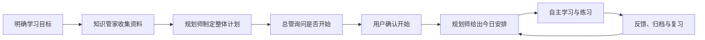

# 知行 · AI 学习群

> **把想学，变成学会。**
>
> 一个学习目标，一个专属学习群。四位 AI 分工协作，陪你找到资料、制定计划、练习表达，最终留下自己的学习成果。

[打开学习 Demo](https://ai-learning-web.syl-pi-agent.workers.dev) · [浏览一页项目介绍](https://ai-learning-web.syl-pi-agent.workers.dev/introduction.html) · [查看完整源码](https://github.com/xiaoyaxy/ai-learning-system/tree/codex/initial-implementation)

项目介绍无需登录；学习 Demo 需要访问密码。当前为个人、多项目学习 demo。

**源码目前位于 `codex/initial-implementation` 分支。** 仓库默认 `main` 分支展示本介绍，完整应用代码和运行文件请切换到[开发分支](https://github.com/xiaoyaxy/ai-learning-system/tree/codex/initial-implementation)。

## 学习理念

**以成果为导向、以主动回忆为核心，通过“先表达、再反馈”和间隔复习，把学过的知识转化为能讲清、会应用的能力。**

让每一次学习，都留下“我真的会了”的证据：从自己的原始理解出发，围绕具体交付物学习，通过回答、追问、练习和复盘发现缺口，再持续调整计划。

## 四个角色，各有所长

你可以在同一个群里与总管交流，也可以直接 @ 专家。每个角色都有明确的职责与产出。

| 角色                      | 负责什么                                                     | 留下什么                     |
| ------------------------- | ------------------------------------------------------------ | ---------------------------- |
| **学务总管 · Supervisor** | 理解意图、召唤专家、串联阶段，让交接过程清楚可见             | 任务分发与协作记录           |
| **规划师 · Planner**      | 明确学习目标，安排整体路线、课程与今日任务，依据反馈调整计划 | 项目定义、学习计划、今日安排 |
| **知识管家 · Curator**    | 联网收集资料、整理知识地图，保存学习卡与复习记录             | 资料链接、知识地图、学习档案 |
| **陪练官 · Coach**        | 先让你回答，再追问与反馈，通过表达和迁移发现理解缺口         | 练习记录、反馈、成果审阅意见 |

## 从“我想学”开始，每一步都有下一步



1. **明确目标**：把宽泛的“我想学 X”收缩为有范围、有产出的学习项目。起点诊断可随后补充，保存用户的原始理解。
2. **收集资料**：知识管家围绕目标搜索入门、核心和案例资料，保存来源链接并整理知识地图。资料编号（如“资料 M01”）用于引用，与“第 1 课”的课程顺序分别管理。
3. **制定整体计划**：规划师把目标和资料组织成课程、技能点与阶段产出，每节课关联对应资料。
4. **确认开始**：总管询问是否开始学习。用户可以先查看计划，准备好后回复“开始”或点击“开始学习”。
5. **领取今日安排**：总管先召唤规划师，再展示今日任务。对话卡片保留简短目标和资料链接，完整内容与时间安排按需打开。
6. **练习与沉淀**：先自己回答，再接受追问和反馈；整理学习卡、审阅自己的成果，安排间隔复习与复盘，发现缺口后调整计划。

例如：把“学习 AI Agent”收缩为“做出能查资料、整理答案的小助手，并留下第一版设计与运行说明”。一页介绍中提供了这一场景的六步交互演示；演示本身不调用大模型。

## 从看懂，到说清，再到做出来

### 学习有路可循

整体计划与今日安排彼此关联。卡片简短，资料可点，完整内容按需打开，让注意力回到今天要做的事。资料、知识点和课程数量显性展示，知识管家的工作可以被看见。

### 理解经得起追问

主动回忆、先答后评、换例迁移。完成检验先确认政策，覆盖完整题目后按 **80% 门槛**判断是否通过。学习卡引用用户实际表达，缺项会补问；成果审阅给出意见，并保留用户原稿。

### 积累看得见

答题、学习卡、成果和复盘记录保存在后端，刷新后可以继续，并支持 Markdown 导出。不同学习项目独立管理，可以暂停和继续；学习群可以删除后恢复，也可以输入群名确认后彻底删除关联记录。

## 技术实现

| 层次           | 实现                                                                        |
| -------------- | --------------------------------------------------------------------------- |
| Web 界面       | React、Vite、TanStack Query                                                 |
| API 与协作编排 | Hono、Cloudflare Agents SDK                                                 |
| 持久化         | Cloudflare D1 与 Agent 持久状态                                             |
| 模型           | OpenAI 兼容 Chat Completions 接口；当前 demo 接入 DeepSeek `deepseek-flash` |
| 联网搜索       | Tavily                                                                      |
| 部署           | Cloudflare Workers，单一 demo 环境                                          |

## 快速跑起来

需要 **Node.js 24、npm 11**。先获取包含源码的分支：

```sh
git clone --branch codex/initial-implementation https://github.com/xiaoyaxy/ai-learning-system.git
cd ai-learning-system
npm ci
npm run demo
```

打开 [http://127.0.0.1:8787](http://127.0.0.1:8787)。未配置 `.dev.vars` 时无需账号或 API Key，使用明确标注的本地固定模型／搜索回复。数据库保存在 `.wrangler/demo`，与自动测试数据分开。固定回复用于演示流程，不能据此判断真实 AI 教学质量。

若已有服务端 `.dev.vars` 配置，`npm run demo` 会使用指定的真实模型和搜索，并保留同一份本地数据。

### 接入真实 AI

```sh
cp apps/api/.dev.vars.example apps/api/.dev.vars
# 填写 MODEL_NAME、MODEL_API_URL、MODEL_API_KEY、SEARCH_API_KEY
npm run migrate:local
npm run dev
```

默认适配 OpenAI 兼容接口和 Tavily 搜索，也提供 Workers AI binding 适配。模型需要支持 JSON 输出。DeepSeek 可配置模型 `deepseek-flash`、URL `https://api.deepseek.com/chat/completions`，并设置 `MODEL_THINKING=disabled` 优先演示速度。密钥由使用者自行配置，只放在被忽略的服务端 `.dev.vars` 或 Cloudflare Secrets 中。

### 检查与部署

```sh
npm run typecheck
npm test
npm run build
npx playwright install chromium
npm run test:e2e
```

仅使用一个 demo 云环境，不分 staging／production。首次部署配置完成后，执行 `npm run migrate:remote`、`npm run deploy`。详细步骤见[运行与部署](https://github.com/xiaoyaxy/ai-learning-system/blob/codex/initial-implementation/docs/deployment.md)。重新部署不会自动更换访问密码。

本机需要网络代理时，可将 `HTTPS_PROXY`、`HTTP_PROXY` 和 `NODE_USE_ENV_PROXY=1` 放到被忽略的 `.env.proxy`；本地启动会自动读取。浏览器测试使用独立配置，不加载个人 `.dev.vars`。

## 源码与文档

以下文件均位于[开发分支](https://github.com/xiaoyaxy/ai-learning-system/tree/codex/initial-implementation)：

| 目录                                                                                                                      | 内容                                                                        |
| ------------------------------------------------------------------------------------------------------------------------- | --------------------------------------------------------------------------- |
| [apps/web](https://github.com/xiaoyaxy/ai-learning-system/tree/codex/initial-implementation/apps/web)                     | 群聊、项目管理、交互卡片、学习档案；`public/introduction.html` 为独立介绍页 |
| [apps/api](https://github.com/xiaoyaxy/ai-learning-system/tree/codex/initial-implementation/apps/api)                     | 角色编排、持久任务、资料、测验、计划调整、归档与供应商适配                  |
| [packages/contracts](https://github.com/xiaoyaxy/ai-learning-system/tree/codex/initial-implementation/packages/contracts) | 命令、公开 DTO 和校验                                                       |
| [tests/e2e](https://github.com/xiaoyaxy/ai-learning-system/tree/codex/initial-implementation/tests/e2e)                   | 真实本地 Workers／D1 的浏览器流程，使用固定供应商替身                       |

[产品需求](https://github.com/xiaoyaxy/ai-learning-system/blob/codex/initial-implementation/AI学习多Agent系统-岗位卡片.md) · [技术设计](https://github.com/xiaoyaxy/ai-learning-system/blob/codex/initial-implementation/docs/technical-design.md) · [实施计划](https://github.com/xiaoyaxy/ai-learning-system/blob/codex/initial-implementation/docs/superpowers/plans/2026-10-14-ai-learning-system.md) · [验收记录](https://github.com/xiaoyaxy/ai-learning-system/blob/codex/initial-implementation/docs/acceptance.md)

## 当前 Demo 范围

- 当前资料采集提供搜索摘要和来源链接，默认不抓取任意网页全文；检索摘要与原文核对状态分别展示。
- AI 输出与教学质量仍需使用者核对。自动化测试验证系统行为，不能替代真实学习效果评估。
- 间隔复习记录保留在应用中，尚未配置外部推送提醒。
- 界面用 Asia/Beijing 表示北京时间，底层使用标准 IANA Asia/Shanghai 计算日期。
- 模型、搜索与访问凭据保存在服务端，不写入 README、浏览器脚本或源码。

**下一个想学的东西，交给你的学习团队。** [从一句“我想学……”开始](https://ai-learning-web.syl-pi-agent.workers.dev)。
