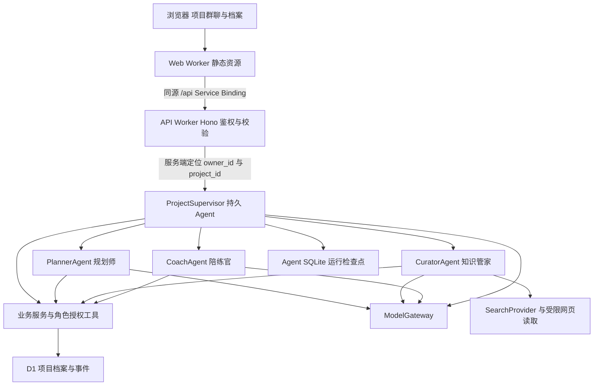
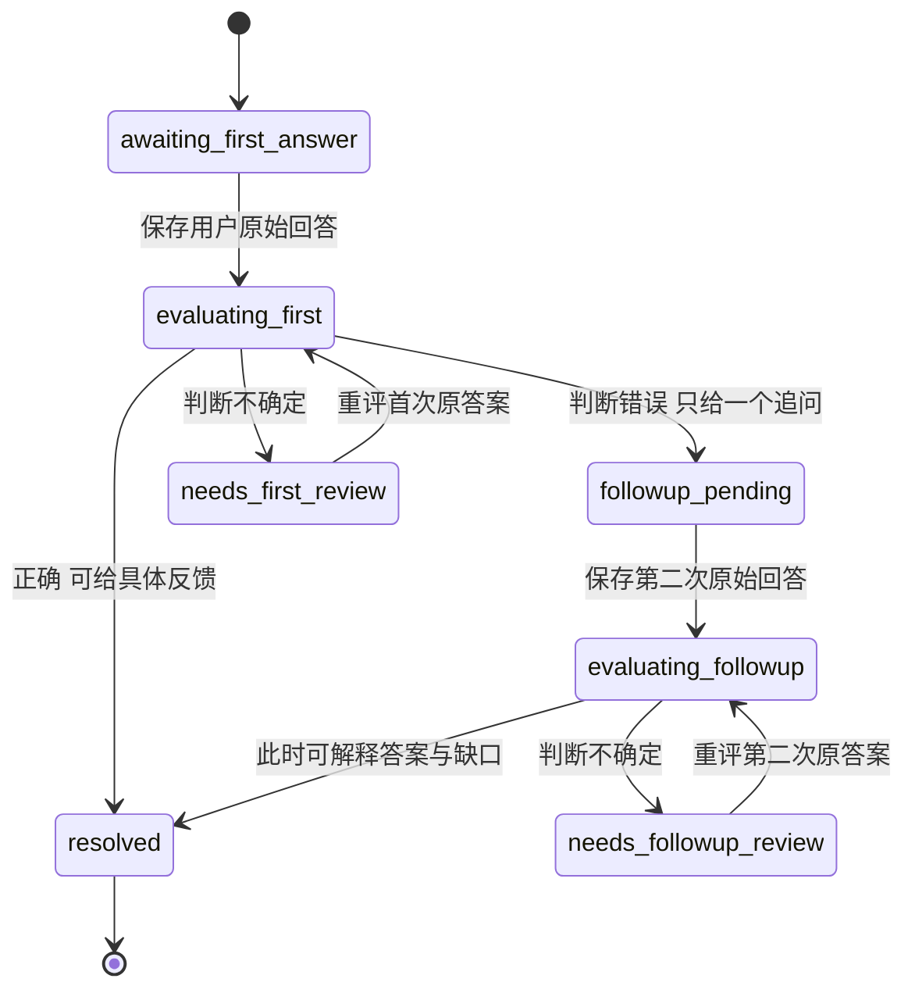

# AI 辅助学习系统技术设计

版本：v0.2｜日期：2026-10-14｜状态：实施评审稿

以 [MVP 需求文档](superpowers/specs/2026-10-13-ai-learning-system-design.md) 为产品依据，实现个人、多项目、四角色群聊式学习闭环。采用前后端分离、Cloudflare Agents SDK 和 D1；群内可见派活与交接，后端强制执行角色权限、先答后评和目标变更请示。当前工作区只有文档与 HTML 演示，下面的应用结构、接口和限额是拟实施设计。

## 1. 需求落实与设计边界

### 1.1 已确认约束

- 当前仅一人使用，同时支持多个学习项目，各自安排学习时间。
- 独立网页、群聊模式，学务总管主要派活，用户可以直接 @ 任意角色。
- 四角色为学务总管、规划师、知识管家、陪练官。
- 自动联网搜集资料；原始诊断不可覆盖，答题与调度记录只追加。
- 日常调整可自主执行；可能影响用户明确目标时，先请示、后生效。
- 项目相关考题答对至少 80% 是完成标准；初稿、终稿不增加额外完成门槛。
- 前后端分离，Cloudflare 一体部署，Cloudflare Agents SDK、D1，免费方案优先。

### 1.2 本次技术选择

以下属于设计者提出的实现选择，可在实施评审中调整，不记为用户逐项确认。

| 决策 | 方案与理由 |
| --- | --- |
| 项目与群 | 一个学习项目对应一个群；共享角色定义，隔离上下文、档案和运行实例 |
| 前端 | React、Vite、TypeScript、TanStack Query；以现有原型的群聊与档案布局为交互参考 |
| 后端 | Hono、TypeScript、Zod、Cloudflare Agents SDK；业务流程自定义，不额外引入通用多 Agent 编排框架 |
| 数据访问 | 首版使用 D1 prepared statements 和 SQL migrations；暂不引入旧方案中的 Drizzle，便于显式检查条件写入与事务 |
| 前端路由 | 首版只需项目列表与工作台，使用 URL 中的 project_id；不将 TanStack Router 设为必要依赖 |
| 执行模式 | 项目总管持久化调度，三位专家通过 SDK 子 Agent RPC 执行有界任务，学习规则由业务状态机约束 |
| 状态展示 | 持久事件增量轮询，运行中每 2 秒、空闲每 15 秒；页面隐藏停止轮询，返回时补齐。首版不用 SSE/WebSocket，减少连接与恢复复杂度 |
| 运行恢复 | 业务步骤检查点、幂等提交、SDK 持久调度回调；不把一次异步模型调用等同于可恢复流程 |
| 周报与复习 | 按需发起周末四问与周报；1 天／3 天复习进入任务卡；自动推送范围继续待定 |
| 生产配置 | 模型、搜索、鉴权和评分规则通过显式配置接入，不在代码中固化原型演示值 |

### 1.3 尚未确认的产品规则

| 项目 | 实施处理 | 启用真实行为前需要什么 |
| --- | --- | --- |
| 完成检验 | 建立版本化 AssessmentPolicy；未确认时状态为 policy_required，不输出达标判断 | 题数、覆盖、量表、部分正确处理、首次／纠错答案口径及单轮／多轮规则 |
| 时间安排 | 保存用户原话 time_constraint_text 与显式约束；结构化设置可为空 | 每日预算、固定时段及缺席处理方案 |
| 自动提醒与推送 | notification_mode 为未配置；不建立用户提醒任务 | 用户确认提醒范围与频率 |
| 模型与搜索 | 提供适配接口、确定性测试替身；真实配置缺失时显示 configuration_required | 供应商、模型标识、凭据与额度 |
| 登录与域名 | 本地测试身份与生产鉴权严格区分；生产鉴权未配置则拒绝访问 | 登录方式、本人身份与域名 |

参考政策可用测试夹具验证 4/5 = 80%，但夹具不进入生产配置。运行限额、分页、重试次数是工程默认值，不属于学习评分或延期阈值。

## 2. 部署与运行架构



同仓库两个独立应用：Web Worker 发布 Vite 静态产物并通过 Service Binding 转发 `/api/*`；API Worker 运行 Hono、D1 访问与 Agents。浏览器不直接访问子 Agent 路由或 RPC。Service Binding 支持 Worker 间调用；采用 HTTP fetch 转发，保留统一错误、鉴权与版本契约。[Service Bindings 官方文档](https://developers.cloudflare.com/workers/runtime-apis/bindings/service-bindings/)

`ProjectSupervisor extends Agent<Env, RuntimeState>` 通过服务端生成的 `${ownerId}:${projectId}` 定位。`PlannerAgent`、`CuratorAgent`、`CoachAgent` 扩展 Agent，并从 API Worker 入口导出；父实例用 `subAgent(RoleClass, roleName)` 取得专家。顶层总管配置 Durable Object binding 与 SQLite migration，子实例按当前 SDK 的子 Agent 机制创建；实施任务 T01 必须验证选定版本支持这一接口。各项目同名专家属于不同父实例，不共享记忆。[Agents 运行时](https://developers.cloudflare.com/agents/)、[子 Agent 官方接口](https://developers.cloudflare.com/agents/runtime/execution/sub-agents/)

专家只接收服务器构造的 RoleTask 和项目上下文，返回结构化 RoleResult。子 Agent 不拥有独立自动循环或公开发起工具调用的入口。总管协调每次交接，不允许专家互相派活绕过总管。

### 2.1 代码责任分布

```text
apps/web/src/features/projects/     创建、切换、项目约束
apps/web/src/features/chat/         群聊、@、角色消息、交接与运行状态
apps/web/src/features/assessment/   当前题、作答、反馈与成绩证据
apps/web/src/features/archive/      计划、资料、笔记、成果、导出
apps/web/worker.ts                  静态资源与 /api 转发
apps/api/src/http/                  路由、鉴权、公共 DTO
apps/api/src/agents/                总管和三位专家、模型提示词
apps/api/src/runtime/               检查点、预算、恢复与执行上下文
apps/api/src/domain/                业务状态机、角色权限、目标影响、评分
apps/api/src/features/              项目、资料、规划、测验、归档服务
apps/api/src/db/                    参数化查询、提交收据与迁移
apps/api/src/providers/             模型、搜索、网页提取适配
packages/contracts/src/             公共请求、响应、事件与 Zod schema
tests/e2e/                         跨前后端验收
```

公共 contracts 不导出评分参考、凭据、内部提示词或执行权限。各业务模块就近放服务与测试，不把全部业务塞进 Agent 类或单个 router。

### 2.2 兼容验证

拟使用 npm workspaces、Node.js 22 LTS 开发工具、TypeScript strict；Workers compatibility_date 固定为 `2026-10-13`，SDK 所需兼容标志在 T01 根据实际类型与本地运行核对。依赖版本在 T01 选定兼容组合并提交 package-lock.json，不以文档中的“最新”代替版本锁定。

T01 证明三件事：父子 RPC 可以调用；持久调度回调可以重新读取检查点；Web Worker 的 Service Binding 可以访问 API Worker。失败时保留 Cloudflare Agents SDK 与 D1 约束，修正兼容配置；不得悄悄更换框架。

## 3. 数据模型与一致性

### 3.1 D1 是业务事实来源

所有跨页面恢复、查询、复算和导出的内容以 D1 已提交记录为准。Agent SQLite 保存调度检查点、当前步骤、待输入标识与取消信号；不复制一套可独立修改的学习档案。两种存储没有共同事务。

| 表 | 核心字段与写入规则 |
| --- | --- |
| projects | id、owner_id、name、timezone、goal_version、revision、run_epoch、phase；约束原话与结构化值独立保存 |
| project_constraints | 项目、目标版本、kind、用户原话、结构化值；明确目标／范围／期限／时间承诺，修改保留历史 |
| messages | 项目、seq、sender_role、原始 body、关联 run_id；用户原话与正式角色消息只追加 |
| artifacts | 项目、kind、version、内容、evidence_message_ids、created_by、supersedes_id；项目定义、诊断、计划、任务卡、地图、卡片、笔记、初稿、终稿、审稿、周报、索引 |
| sources | 项目、资料编号、层级、URL、标题、fetched_at、访问／核验状态、摘要与引用；保留获取版本 |
| assessment_policies | 项目、版本、状态、口径 JSON、用户确认消息 ID；draft / confirmed，确认版本不可覆盖 |
| assessment_sessions | 项目、purpose、policy_version、goal_version、目标技能覆盖、题目清单、状态；diagnostic / practice / completion 区分 |
| quiz_questions | 项目、session_id、题型、skill_id、prompt、rubric_version；公共题目不含答案 |
| question_secrets | 项目、question_id、评分量表、参考答案、解释；仅服务端受控读取 |
| quiz_attempts | 项目、question_id、attempt_index、原始回答消息 ID、提交时间；只追加，唯一题目＋回答序号 |
| quiz_evaluations | 项目、attempt_id、policy_version、verdict、gap、feedback、reveal_allowed；只追加，修订引用前一记录 |
| review_schedule | 项目、skill_id、基准学习日期、offset_days、项目本地 due_date、形式、完成证据；生成 1 天／3 天项 |
| plan_proposals | 项目、base_plan_version、base_goal_version、变更、估计、约束比较、impact、status；待决策方案独立于生效计划 |
| decisions | 项目、proposal_id、原始用户消息 ID、accept / retain / pause；只追加并记录适用版本 |
| agent_runs / run_steps | 项目、run_id、来源操作、epoch、状态、步骤结果引用、预算、失败码；检查点可从提交收据复建 |
| command_receipts | 项目、client_operation_id、payload_hash、接受结果；唯一项目＋操作 ID，保存重复请求的原响应 |
| project_creation_receipts | owner_id、client_operation_id、payload_hash、project_id、创建响应；唯一本人＋操作 ID，支持项目存在前的创建幂等 |
| step_receipts | 项目、operation_id、step_key、epoch、base_revision、结果引用；唯一操作＋步骤，事务防护入口 |
| domain_events | 项目、递增 seq、事件类型、公开载荷、关联实体；只追加，供群聊与补拉使用 |
| provider_calls | 项目、run_id、call_id、request_hash、状态、已知用量；区分成功、失败、结果未知 |

各子表以 `(project_id, entity_id)` 的复合引用约束跨项目关联。按项目＋序号、项目＋类型＋版本、项目＋到期日建索引。单页消息／事件最多 50 条；正文限制 12,000 Unicode 字符，请求体限制 64 KiB，限制由服务端再次校验。

数据库触发器禁止 UPDATE/DELETE 原始诊断、用户原话、答题、批改、调度与确认政策。笔记修改生成新版本，删除创建 tombstone，只允许知识管家；历史版本和证据仍保留。初稿与终稿由用户提交服务原样保存，知识管家只能索引归档；不授权 AI 重写。

### 3.2 命令幂等与项目串行化

所有项目内改变状态的请求经总管接收，包含 `client_operation_id` 和 `expected_revision`。命令类型使用 Zod discriminated union，客户端不能提交 actor_role、owner_id 或任意工具名。

接收时先鉴权并检查项目所有权，再检查 command_receipts：同 ID、同 payload_hash 返回原接受结果并标 replayed；同 ID、不同内容返回 `409 IDEMPOTENCY_CONFLICT`。payload_hash 使用规范化后的完整原始命令信封，重试保持原信封。之后检查 revision，在短 D1 batch 内保存原始消息、命令收据与待执行 run。运行中的项目对普通新命令返回 `409 RUN_BUSY`，不静默丢弃或无限排队；暂停、补充要求与取消走控制命令。不同项目可独立运行。

DO 在 await 外部调用时仍可能处理其他请求，因此不能只依赖“单个 DO”保证串行。短提交用服务器运行锁与 D1 revision 校验；模型调用在锁外，返回后再核对 run_epoch 与状态。

### 3.3 步骤提交与恢复协议

1. 每步的身份为 `(project_id, operation_id, step_key)`。开始前读取 step_receipts；已提交则直接恢复结果引用，不重做模型调用或业务写入。
2. 调用外部服务前记录 provider_calls。外部生成结果先校验类型、权限和业务前置条件，尚未提交的文本不进入正式群消息。
3. 一个 D1 batch 原子插入 step_receipt、业务记录、公开事件，并递增 revision。step_receipts 的 BEFORE INSERT 触发器核对项目 revision、run_epoch；不符时 `RAISE(ABORT)`，使整个 batch 回滚。只检查 UPDATE 影响行数不够，不能让旧成果先插入后才发现冲突。
4. 提交成功后更新 Agent 检查点。若此时实例重启，读取 D1 收据和 run_steps 对账恢复；不重复写入。
5. 接收命令后先安排 SDK 持久回调 `advanceRun`，再向客户端确认接受。回调开始前安排同一 run 的恢复检查，成功后取消；重启的 onStart 及用户重开项目也会对账待执行 run。D1 接受后、调度前故障通过重试同操作或重开恢复，不宣称双存储原子接受。
6. 持久回调只负责已接受任务的推进与故障恢复，不代表启用了用户定时提醒。[SDK schedule 接口](https://developers.cloudflare.com/agents/runtime/execution/schedule-tasks/)

D1 batch 的语句失败会回滚整个批次；本设计使用这一事务边界，不用不受支持的任意跨请求事务。[D1 batch 官方语义](https://developers.cloudflare.com/d1/worker-api/d1-database/#batch)

业务写入可以保证幂等，外部调用不能笼统保证恰好一次。供应商有幂等键时传 call_id；没有时，崩溃后的未知结果标为 outcome_unknown，向用户提供重试并说明可能再次产生用量。已知结果保存为服务端步骤缓存，过期 epoch 的结果不提交。

## 4. 公共契约与状态

以下为项目自己的业务接口，SDK 接口只在 Agent 适配层出现。

```ts
type Role = 'supervisor' | 'planner' | 'curator' | 'coach';
type RunStatus = 'queued' | 'running' | 'waiting_user' | 'waiting_dependency'
  | 'waiting_decision' | 'paused' | 'succeeded' | 'failed' | 'cancelled';
type Phase = 'scoping' | 'diagnosis' | 'preparing' | 'learning'
  | 'practicing' | 'reviewing' | 'completion_check' | 'completed';
type GoalImpact = 'none' | 'affected' | 'unknown';
type CompletionStatus = 'policy_required' | 'in_progress' | 'pending_review'
  | 'not_met' | 'met' | 'stale';

interface CommandEnvelope {
  client_operation_id: string; // UUID
  expected_revision: number;
  command: ProjectCommand;    // 判别联合，详见 API 表
}
interface AcceptedCommand { run_id: string; revision: number; replayed: boolean }
interface PublicEvent {
  project_id: string; seq: number; type: PublicEventType;
  run_id: string | null; role: Role | null; occurred_at: string;
  payload: PublicEventPayload; // 类型白名单，不能是任意模型对象
}
```

`PublicEventType` 为 message_committed、task_assigned、role_status_changed、handoff_committed、artifact_committed、plan_proposed、decision_required、plan_activated、question_presented、feedback_committed、completion_changed、run_failed。只展示任务目的、等待对象、交接结果与简明依据；不展示模型思维链、完整提示词或私有评分参考。

Phase 表示学习位置，RunStatus 表示一次协作状态，两者不混用。waiting_user / waiting_decision 持久化 `pending_input = {kind, entity_id, version, expected_role}` 后结束执行，等待期间不保持模型请求。允许重访学习阶段和用户主动跳阶段；跳过的内容记录为 skipped，不能伪造成已测验或已掌握。

## 5. 调度与角色权限

### 5.1 普通消息与 @

前端选择器提交可选 target_role。文本中从开头解析一个 `@学务总管`、`@规划师`、`@知识管家` 或 `@陪练官`，归一为四个枚举；显式选择与前缀不一致时提示用户修正，不猜测。其余正文原样保存；多重开头 @ 返回 `422 AMBIGUOUS_MENTION`。

普通消息：总管使用当前阶段和已提交上下文输出路由建议，服务器检查 permitted_action。@ 消息：总管记录指定对象并优先路由给该专家，仍检查阶段与工具权限。测验等待状态下普通输入默认作为当前题回答；用户选择“另问问题”才作为消息，避免把卡点问题误判为答案。测验中 @ 知识管家请求答案时，保留请求并说明需先作答，不调用会泄题的讲解工具。

陪练官的反馈固定交接：`coach → supervisor → planner`。总管提交 handoff_committed 后，规划师才获得带反馈引用的调整任务；专家不能直接改其他角色的档案。

### 5.2 服务器工具授权

| 执行主体 | 允许业务写入 | 明确禁止 |
| --- | --- | --- |
| supervisor | 调度、任务交接、目标请示与运行控制 | 写知识、批改、计划、笔记 |
| planner | 项目定义、引用原始消息的诊断、计划版本、今日任务卡、调整提案 | 搜索、讲解、批改与笔记 |
| curator | 资料、地图、学习卡、笔记版本／tombstone、复习排期、索引、周报与归档链接 | 改计划、诊断、原始答案或用户初稿／终稿 |
| coach | 题目与私有评分参考、答题后的评价、结构化缺口建议、审稿与查证清单 | 改计划、笔记，代写终稿 |
| trusted_ingress | 原样保存用户消息、答案、初稿、终稿、确认与目标修改请求 | 生成用户理解、自动确认政策或目标变更 |
| runtime | 收据、步骤、错误、用量、公开事件投影 | 生成学习内容与学习成绩 |

`ToolContext` 的 project_id、owner_id、actor、run_id、epoch 由服务端封装生成，模型不能替换。工具只暴露具名动作，拒绝任意 SQL、通用文件修改和任意 fetch。公共查询在 API 层构造 DTO；禁止把数据库行或模型返回对象直接 JSON.stringify 给客户端。

## 6. 学习闭环实现

### 6.1 定题与起点诊断

规划师最多提出三个定题澄清问题，计数持久保存；已有目标信息充足时直接形成项目定义。三问后仍缺关键事实，保持 scoping 并展示缺失字段，允许用户主动补充，不能编造答案或进入教学。诊断另行保存用户 message_id 及原文，不计入完成成绩。

项目定义绑定成果初版里程碑与边界；1 至 2 天是初版建议，不替换用户整个项目期限。时间约束原话保持完整，未确认结构化形式时不得替用户承诺每日分钟数或固定时段。

### 6.2 资料、知识地图与任务卡

知识管家按入门／核心／案例查询，保存来源状态和支持引用。知识地图包含领域问题、5 至 7 个概念、关系与三个误解；每个关键定义包含 citation_ids 或 `verification_status = pending`。缺一层资料则展示 partial 与缺项，可继续补搜，不能当作完整资料包。

规划师引用资料编号生成计划和任务卡，含目标、材料、深度／补充／反思三个时间块、产出物、到期复习项。没有已确认时长则列为建议或待设置，不编造用户的时间预算。30 秒可读完是展示目标，由人工体验评估，不用虚构字数公式替代。

### 6.3 测验与先答后评

学习位置与题目分别持久化；当前一次只展示一个问题。



私有答案与量表不进入公开事件、档案导出、未作答工作台 DTO 或其他角色模型上下文。第一轮错误反馈只允许具体缺口和一个不揭底的追问，不输出解析；不能把私有批改生成过程流式展示。第二次后才允许答案解释。正确答案可在用户作答后反馈。模型输出不确定时记录 needs_review，不强判错误，不纳入最终达标判断。

日常练习覆盖概念复述、对比辨析、场景应用，再以概念区分、实际应用、误区、边界、讲给外行听五种追问及新场景迁移检查理解。一次追问与揭示规则针对每题；五种追问按需要分题交互，不一次抛给用户，也不把五种追问强加为完成检验题数。

原始回答先保存，批改另追加；批改失败保留待评状态，重试不再创建相同答案。提交答案使用 question_id、question_version 与 attempt_index 校验；过期题或其他项目的题返回冲突，不消耗模型调用。

### 6.4 目标影响与计划生效

`evaluateGoalImpact(constraints, proposal)` 输出 none / affected / unknown 和比较依据。将计划变更与用户已明确的目标、范围、期限、时间承诺逐项比较；预计结束晚于明确 deadline 或削减范围为 affected，缺少可比较估计且可能改变约束为 unknown。unknown 按保守优先请示，不能把估计不明当作没有影响。

工作量估计由规划师提出，保留依据与不确定性；最终约束检查由代码执行。无目标影响的调整，规划师自动激活新计划并在群内告知。affected / unknown 只保存 proposal，由总管展示原目标、影响、依据和选择，设 waiting_decision；不更新有效计划或项目目标。

用户选择 accept 时，trusted_ingress 保存决定；如涉及目标修改，先形成目标新版本，规划师重新校验并激活计划。retain 时保留原目标并要求规划师在原约束内重排；pause 时保留提案与旧计划。决策必须匹配提案、计划和目标版本，旧确认不能批准新方案。总管发起请示但不代替规划师写计划。

### 6.5 掌握成绩与 80% 门槛

AssessmentPolicy 包含：题目数量与技能覆盖、开放题量表、partial_rule、attempt_basis、aggregation、确认来源。确认后绑定不可变版本；修改政策创建新版本，不重写旧成绩。

完成检验 session 只接收与目标绑定的题，要求政策规定的题目全部有可判定结果且覆盖校验通过，才计算 `correct_count / total_count`。80% 比较使用整数 `correct_count * 100 >= total_count * 80`，不依赖四舍五入后的百分比。分母包含规定的错误题，不挑选简单题或只统计已答对题。

无确认政策为 policy_required；未答完为 in_progress；未决判断为 pending_review；低于 80% 为 not_met；达标为 met。诊断与日常练习不得混入。首次／纠错答案和单轮／多轮由确认政策决定；部分正确按政策映射为正确或错误，未配置不能自行计半题。

目标版本变化时，在同一业务提交中使当前完成投影失效并标 stale，保留旧结果但不作为新目标的完成证据；completed 项目重返 learning，不继续显示新目标已完成。达到 met 才将 phase 转 completed；成果归档状态独立，不另加成果评分门槛。成绩公开投影列出题目、适用回答、每题判定、政策版本、分子分母和覆盖，允许重新计算。

### 6.6 归档、复习与成果

学习卡四个部分只引用用户实际表达的消息和答案；缺少“读懂的三点”时保留缺项并补问，不用资料内容补齐。笔记与易错卡引用不可变答题记录。

知识管家按项目时区的学习基准日期生成 +1 天“重讲三句话”、+3 天“换例讲”复习，交总管转规划师纳入任务卡。到期未完成项保留，不能推断未登录即缺席，更不能自行延期。

按需周末复盘一次提出一个问题：起点误解、最有帮助资料、暴露缺口的追问、下次方法调整；四问完成后依据实际回答生成周报与可复算统计。

初稿、终稿由用户分别原样提交；陪练官输出具体段落问题、可执行建议及查证清单，不调用重写工具。版本、价格、政策、数据标核验；医法金只整理问题与查证需求。知识管家归档终稿和引用，不替用户定稿。

Markdown 导出与岗位卡片的项目定义、起点诊断、计划、今日任务卡、资料清单、知识地图、学习卡、笔记、答题记录、index、周报名称对应；包含版本与引用关系，排除未揭示答案、秘密配置和内部模型上下文。

## 7. 暂停、补充要求与故障控制

暂停是持久控制命令：立即递增 run_epoch 并设 paused，取消未来回调，尝试 AbortController 中止在途请求。供应商可能已执行，不能保证撤回用量；旧 epoch 返回值即使成功也不得写入学习档案。

补充要求原样保存，停止当前代际并创建新的协调任务；新任务读取已提交结果和用户新要求重评后续步骤。涉及目标修改时走目标版本规则。继续从已提交检查点生成新代际，不沿用已失效的工具上下文。重试复用 operation_id 与 step_key，不重排已完成计划、不重复答案；cancelled 运行不能重新提交旧结果。

工程默认限额：单次 run 最多 8 次模型请求、12 次业务工具调用、6 次专家交接；最多 2 次单步骤自动重试（额外尝试），单次外部请求超时 30 秒；输出上限 2,048 tokens；一个步骤最多读取 8,000 字符来源片段。重试计入总调用预算；到上限记录 `BUDGET_EXCEEDED` 并停止，可由用户续开新 run，不能通过重试清零预算。

这些默认值先用于有界实现，实际 CPU、模型上下文窗口和教学质量在真实环境验证后调整。HTTP 429 配额不足不立即反复重试；记录 quota_exceeded 与可重试时间，保留检查点。若 D1 本身不可写，不能承诺新错误已存库：返回 storage_unavailable，保留可用的 Agent 检查点，恢复后与 D1 对账。

## 8. 搜索、模型与访问控制

`ModelGateway.generate(RoleModelRequest): Promise<RoleModelResult>` 返回结构化产物、已知用量与 request_id。运行时校验 schema、角色权限和阶段。Workers AI 或用户已有接口均通过这一适配层；中文反馈、结构化输出、约束遵守需要真实模型评估。未配置不使用随机回复冒充 AI。

`SearchProvider.search(query, scope): Promise<SearchHit[]>` 与 `SourceReader.read(url): Promise<SourceReadResult>` 分离。供应商候选 Tavily 等不视为已选择，也不在本稿承诺其当前免费配额。读取只允许公开 HTTPS；限制重定向 3 次、正文 1 MiB、超时 10 秒。每次重定向重新校验地址；拒绝 IP 字面值、localhost、私网及保留地址，不能解析／确认目标时拒绝。实施时必须核验 DNS／代理读取方案能落实公网校验，不能只用字符串规则宣称防护完成。

网页文本为低信任资料，不成为系统指令；提取内容不执行脚本，不授予额外工具。无法读取、来源冲突、引用不支持定义分别记录 inaccessible / conflicting / pending。缓存键包含项目与目标版本、URL、获取时间，避免串用学习范围。公开 Markdown 禁用原始 HTML，链接只允许 http/https，外链使用安全 rel 属性。

生产鉴权候选为 Cloudflare Access 邮箱登录。选择后校验 JWT 签名、issuer、audience、过期时间与配置的本人身份；不得只相信客户端传入的邮箱或头。API Worker 关闭公共 workers.dev 和不必要的公开 route，仅供 Web Service Binding 调用；Web Worker 转发 Access token，API 独立验证。[Access JWT 官方文档](https://developers.cloudflare.com/cloudflare-one/access-controls/applications/http-apps/authorization-cookie/validating-json/)

写请求同时核验同源 Origin、JSON Content-Type 与鉴权；本地绕过身份只在 local 环境生效，生产缺配置则 fail closed。模型与搜索凭据仅在 API Worker secrets。日志只保留错误码、实体 ID、已知用量，不写 token、原始答案和个人资料正文。

## 9. API 与前端呈现

路径均以 `/api/v1` 为前缀。

| 方法与路径 | 契约 |
| --- | --- |
| GET /projects | 本人项目摘要，不根据部分成绩直接宣称已完成 |
| POST /projects | client_operation_id＋项目初始原话；创建也幂等，不要求未确认的每日分钟 |
| GET /projects/:id/workspace | phase、revision、有效计划、角色状态、pending_input、公开当前题、提案、completion、最近消息和 latest_seq |
| POST /projects/:id/commands | CommandEnvelope；异步接受返回 202 AcceptedCommand，已接受的重复请求返回原结果 |
| GET /projects/:id/events?after_seq=N&limit=50 | 仅公开持久事件、游标；按 seq 去重，限制查询当前项目 |
| GET /projects/:id/runs/:runId | 运行状态、已提交步骤、失败码、用量和 retryable |
| GET /projects/:id/artifacts?kind=…&cursor=… | 角色授权后生成的公开档案 DTO 与版本历史，不含未揭示私有答案 |
| GET /projects/:id/export | 项目 Markdown 档案，依据当前可公开状态投影 |

`ProjectCommand` 类型为 send_message、submit_diagnosis、start_learning、start_practice、start_completion_check、submit_answer、decide_proposal、submit_draft、submit_final、start_weekly_review、confirm_assessment_policy、pause_run、resume_run、retry_run、cancel_run、supplement_requirements、request_stage_jump。每种有具名载荷与前置条件，不提供自由 SQL／自由动作字符串。

错误体统一为 `{code, message, retryable, current_revision?, entity_id?}`，公开码包括 UNAUTHENTICATED、FORBIDDEN、REVISION_CONFLICT、IDEMPOTENCY_CONFLICT、RUN_BUSY、POLICY_REQUIRED、CONFIGURATION_REQUIRED、INVALID_STAGE、ANSWER_PENDING、SOURCE_UNAVAILABLE、QUOTA_EXCEEDED、STORAGE_UNAVAILABLE、BUDGET_EXCEEDED。

前端沿用原型的项目列表、群聊主区、按需档案，增加真实运行／失败／等待标记。消息角色、派活与交接有区别，工具细节默认折叠。题目卡、计划变更请示、资料卡和成果卡使用公开事件关联实体读取。暂停入口始终可访问，页面重开从 workspace 与游标恢复。

前端不以 localStorage 存学习事实；它仅保存输入草稿与界面状态，按项目分键。后端确认提交后才显示正式消息，发送中的输入可显示“待保存”。网络断开保留草稿，不静默重发新操作 ID；使用同操作 ID 重试。移动端 320px 起无横向溢出，中文输入法 Enter 不误发送，对话框支持焦点管理与 Escape。

## 10. 免费优先与发布条件

2026-10-14 核对的基础额度如下；账户内共享，不是每个项目独立额度。

| 服务 | 当前官方免费限制与实现影响 |
| --- | --- |
| Workers | 每日 100,000 请求，普通调用每次 10ms CPU；控制 DTO 大小与解析开销，实测 CPU |
| D1 | 每日读 5,000,000 行、写 100,000 行，总存储 5GB；索引、分页、保留用量元数据 |
| Durable Objects | Free 支持 SQLite 后端，配额超限相关操作失败；使用 SQLite migration，按实际 DO 额度验收 |
| Workers AI | 每日 10,000 Neurons，实际模型可用量由模型及输入输出决定；不保证四角色学习全天免费 |

依据：[Workers 价格](https://developers.cloudflare.com/workers/platform/pricing/)、[D1 价格](https://developers.cloudflare.com/d1/platform/pricing/)、[Durable Objects 价格](https://developers.cloudflare.com/durable-objects/platform/pricing/)、[Workers AI 价格](https://developers.cloudflare.com/workers-ai/platform/pricing/)。D1、DO 和 Workers AI 的每日免费额度按 UTC 00:00 重置，对北京时间为 08:00；项目学习日期仍按项目时区计算。

不自动升级付费、切换供应商或降低 80% 门槛。关闭页面后业务任务与等待状态持久保存；失败恢复需要平台存储可用。应用用量只能展示供应商返回的已知数据，未知不记零；账户额度以控制台为准。

发布顺序为迁移 → API → Web。测试与正式环境使用不同 D1 与 Agent 命名空间；迁移优先采用新增字段／表，回滚应用不删除历史。真实运行必须满足：生产鉴权已配置、模型与搜索已配置、兼容检查通过、CPU／配额验证通过。自动完成判定另要求评分政策已确认；政策缺失不阻止学习聊天，但不能标记项目 met。

## 11. 验收映射与交付

| 需求验收 | 设计落点 | 实施任务 |
| --- | --- | --- |
| A01 项目隔离 | owner 检查、项目总管、复合引用、项目草稿分键 | T02、T03、T09 |
| A02 定题 | 三问计数、缺失字段、原话诊断 | T05 |
| A03 @ 专家 | 归一化路由、权限与阶段守卫 | T03、T04、T09 |
| A04 原始诊断 | 不可变消息、诊断触发器 | T02、T05 |
| A05 资料地图 | 三层资料、来源状态、5 至 7 概念／3 误解 | T06 |
| A06 测验 | 待答状态、私有答案分离、一次追问 | T07 |
| A07 反馈调整 | coach→supervisor→planner、版本化提案 | T04、T07、T08 |
| A08 自主调整 | impact=none 自动激活并告知 | T08 |
| A09 目标请示 | affected / unknown 等决定、版本绑定 | T08 |
| A10 学习卡 | 用户表达证据引用、缺项不补造 | T10 |
| A11 复习复盘 | 本地日期 +1／+3、四问与周报 | T10 |
| A12 成果审阅 | 原稿保存、具体意见与查证清单 | T10 |
| A13 完成检验 | 确认政策、覆盖、整数 80%、可复算 | T07 |
| A14 中断重复 | 收据、epoch、防旧提交、重开对账 | T02、T04、T09 |
| A15 异常 | 结构校验、来源失败、额度／存储失败 | T04、T06、T11 |
| A16 协作受控 | 持久公开事件、限额、暂停与角色状态 | T04、T09 |

本设计交付后，按 [实施计划](superpowers/plans/2026-10-14-ai-learning-system.md) 建立代码、逐任务测试和验收。本轮仅更新文档；未创建应用、配置凭据、执行部署或运行真实模型。
